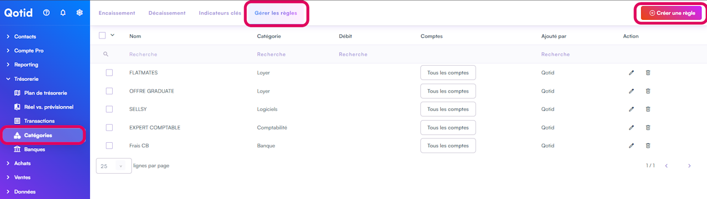
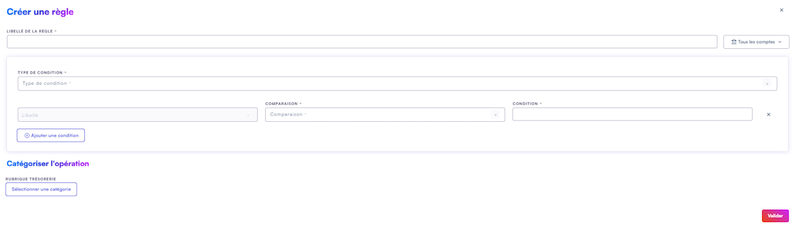

# Comment créer une règle pour catégoriser automatiquement vos transactions ?

## Créez une règle personnalisée

**À savoir :**

Les règles vous permettent de catégoriser automatiquement dans votre tableau de trésorerie vos transactions selon des critères précis

Pour ce faire cliquez sur **Catégories** puis sur **Gérer les règles** puis sur **Créer une règle**

## Créer votre règle personnalisée

Pour créer votre règle vous devez compléter plusieurs champs:

* Choisir un libellé à cette règle
* Sélectionner le nombre de compte sur lesquels la règle s'appliquera : par défaut la règle s'appliquera sur l'ensemble des comptes.
* Le type de condition :
  * **toutes les conditions** : si vous souhaitez que les conditions se cumulent (condition 1 ET condition 2 ET condition 3, etc)
  *   **Une de ces conditions** : si vous souhaitez que les conditions soient indépendantes (condition 1 OU condition 2 OU condition 3, etc)

      Vous pouvez ajouter plusieurs conditions en cliquant sur **Ajouter une condition**
* La catégorie de trésorerie à laquelle sera affecté la transaction si les conditions sont respectées.
* Le numéro de compte : si vous avez l'option vous pourrez également produire une écriture comptable.

Une fois votre règle, cliquez sur **Valider**

**À savoir :**

Toutes les transactions qui seront catégorisées automatiquement via une règle que vous avez créez seront automatiquement validées

**Attention :**

Les règles que vous créez sont prioritaires par rapport aux règles de catégorisation faites par l'IA Qotid.
