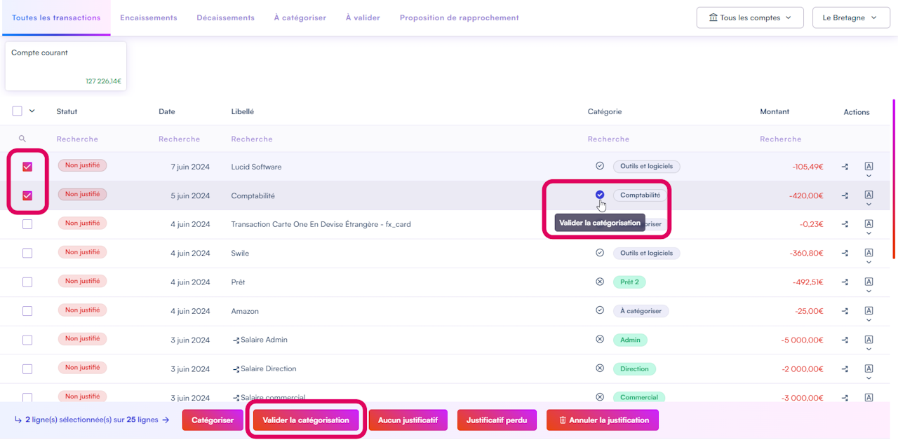

# Comment valider la catégorisation de vos transactions bancaires ?

## Préambule pour valider vos transactions bancaires

**À savoir :**

Valider vos transactions bancaires permet de savoir où vous en êtes et s'assurer que vous êtes d'accord avec la catégorisation proposée par Qotid.

Il est important de noter que lorsque la transaction est catégorisée par un utilisateur ou par une règle que vous avez créé la transaction sera automatiquement validée.

**Attention :**

Même si la catégorisation n'est pas validée, la transaction affectera votre tableau de trésorerie en conséquence. La validation est purement à titre informatif.

## Comment valider la catégorisation de vos transactions bancaires

Lorsque une transaction est catégoriser par Qotid, vous pourrez valider la transaction de deux manières :

* Soit en cliquant sur l'icône Valider
* Soit en cochant plusieurs transactions puis en cliquant sur Valider la catégorisation

## Comment retrouver toutes les transactions à valider

Il existe également un onglet vous permettant de visualiser l'ensemble des transactions à valider en cliquant sur **A valider**

## Comment créer une règle pour catégoriser automatiquement vos transactions ?

Consultez également le guide [Comment créer une règle pour catégoriser automatiquement vos transactions ?](comment-creer-une-regle-pour-categoriser-automatiquement-vos-transactions.md).
