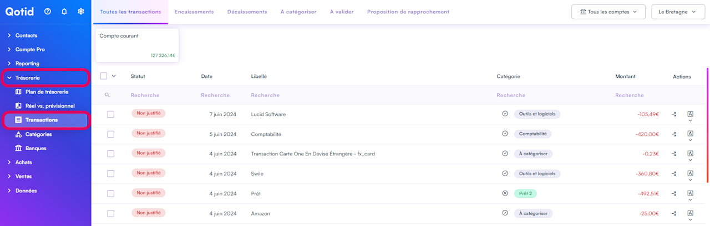

# Comment visualiser vos transactions bancaires ?

## Visualiser vos transactions bancaires

Vous pouvez catégoriser vos transactions bancaires en vous rendant sur "**Trésorerie**" puis "**Transactions**".

## Vos transactions bancaires

Sur cet écran vous pourrez visualiser l'ensemble des transactions crédit ou débit sur un ou plusieurs comptes bancaires.

À partir de cet écran vous pourrez réaliser un certain nombre d'actions

1. Choisir la banque ou le compte bancaire que vous souhaitez visualiser et voir apparaître le solde de chacun.

Si vous avez le module achat, vous pourrez visualiser le statut de la transaction (Justifié, Non justifié, Justificatif perdu ou Aucun justificatif). Vous pourrez ainsi :

1. Lettrer la transaction avec une facture.
2. Indiquer que la transaction n'a aucun justificatif. (Par exemple un prêt ou commissions bancaires)
3. Indiquer le justificatif comme perdu.

Pour finir vous pourrez :

1. Lettrer hors Qotid
2. Catégoriser le flux bancaire.
3. Ventiler la transaction

## Comment catégoriser vos flux bancaires ?

Consultez également le guide [Comment catégoriser vos flux bancaires ?](comment-categoriser-vos-transactions-bancaires.md).
