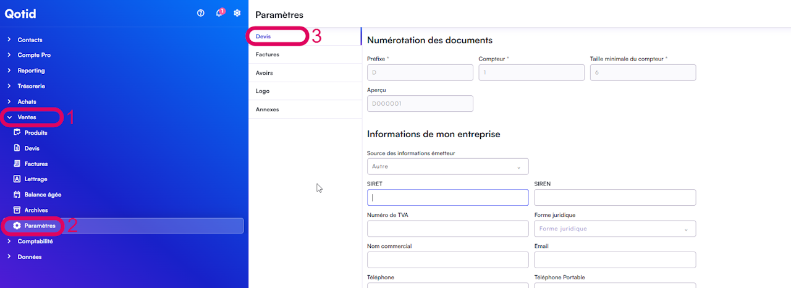
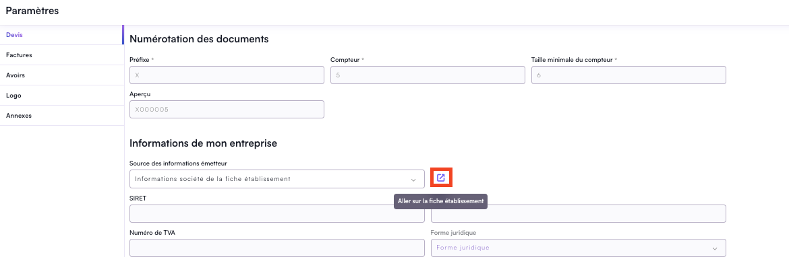
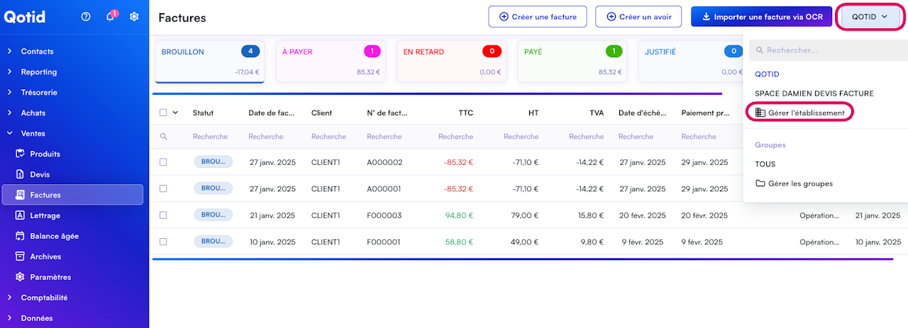
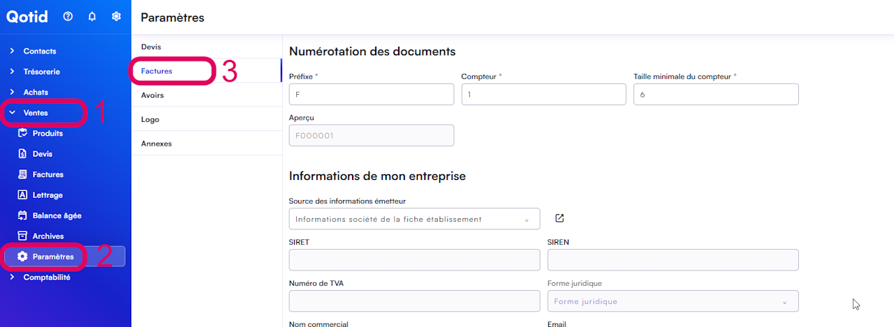

# Comment paramétrer la numérotation de mes factures ?

## Accès aux paramètres

Pour avoir accès aux paramètres de vos factures, vous devez :

1. Sélectionner l'onglet "Ventes"
2. Puis sélectionner l'onglet "Paramètres"
3. Enfin, sélectionner "Factures"

## Paramétrer la numérotation de mes factures

De la même façon que pour vos devis, vous devez :

1. Indiquer le préfixe que vous souhaitez avant votre numéro de facture.
2. Indiquer à quel numéro correspondra votre première facture créée sur Qotid.
3. Indiquer la taille minimale du compteur.
4. Vous aurez un aperçu de la numérotation de votre première facture sur Qotid.

**Attention :**

Si vous créez une facture avant de paramétrer votre numérotation, le préfixe par défaut sera F et le compteur sera 1. Vous ne pourrez plus changer ce paramètre par la suite.

**Chemin : Comment configurer l’affichage des informations de mes clients sur mes factures ?**

## Comment configurer l’affichage des informations de mes clients sur mes factures ?

Ce parcours renvoie vers le guide [Comment configurer l’affichage des informations de mes clients sur mes factures ?](comment-configurer-laffichage-des-informations-de-mes-clients-sur-mes-factures.md).

**Chemin : Comment configurer l’affichage des informations de ma société sur mes devis et factures ?**

## Comment configurer l’affichage des informations de ma société sur mes devis et factures ?

Ce parcours renvoie vers le guide [Comment configurer l’affichage des informations de ma société sur mes devis et factures ?](comment-configurer-laffichage-des-informations-de-ma-societe-sur-mes-devis-et-factures.md).

## Comment configurer l’affichage des informations de mes clients sur mes devis ?

Ce parcours renvoie vers le guide [Comment configurer l’affichage des informations de mes clients sur mes devis ?](comment-configurer-laffichage-des-informations-de-mes-clients-sur-mes-devis.md).

## Comment configurer l’affichage des informations de mes clients sur mes factures ?

Ce parcours renvoie vers le guide [Comment configurer l’affichage des informations de mes clients sur mes factures ?](comment-configurer-laffichage-des-informations-de-mes-clients-sur-mes-factures.md).

## Comment configurer l’affichage des informations de mes clients sur mes factures ?

Ce parcours renvoie vers le guide [Comment configurer l’affichage des informations de mes clients sur mes factures ?](comment-configurer-laffichage-des-informations-de-mes-clients-sur-mes-factures.md).
