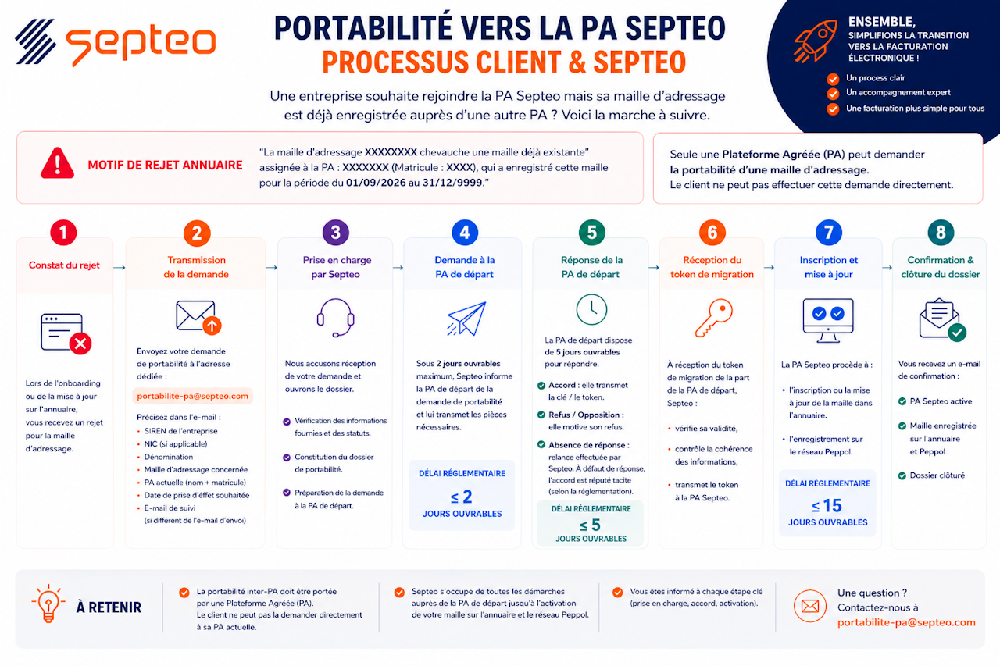

# Comment gérér la portabilité et passer d'une PA à la PA SEPTEO ?

## Portabilité vers la PA SEPTEO

Pour demander à ce que la PA Seteo récupère vos mailles d'adressage, vous devez écrire un email à : portabilite-pa@septeo.com.

A minima il faut préciser :

* SIREN concerné
* PA activé : elle est indiqué sur le message d'erreur
* Maillage à récupérer : Indiquer "récupération Totale" si vous souhaitez migrer l'ensemble de vos adresses de reception vers la PA SEPTEO sinon il faut préciser les mailles concernées
* Date de démarrage de la récupération des mailles

Plus d'info dans l'infographie suivante
