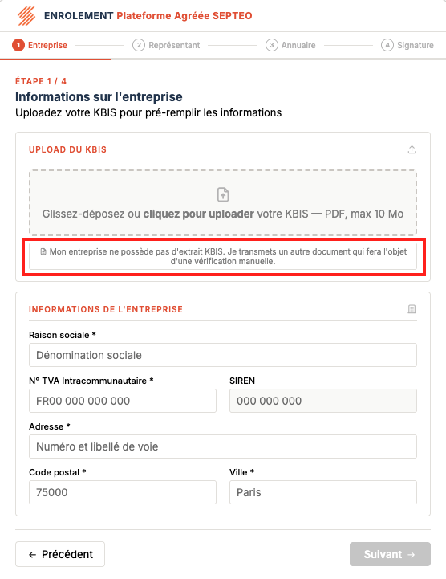

# Comment s'onboarder sur la plateforme Agréée Septeo ?

## Onboarding PA Septeo

Merci de regarder attentivement la vidéo qui explique comment onboarder votre entreprise sur la PA Septeo.

## Cas particuliers

* Si votre société n'a pas de KBIS, vous pouvez déposer un autre document dans le second cadre
* Si le représentant légal est une entreprise, vous devez fournir l'ensemble des extraits Kbis de la chaîne de sociétés jusqu'à identifier une personne physique.
* Si vous avez une demande en cours que vous n'avez pas pu finaliser, vous pouvez relancer une inscription, la nouvelle demande "écrasera" la précédente.

**À savoir :** Si vous n'arrivez pas à faire votre enrôlement merci de contacter le support à l'adresse suivante : support@qotid.com
