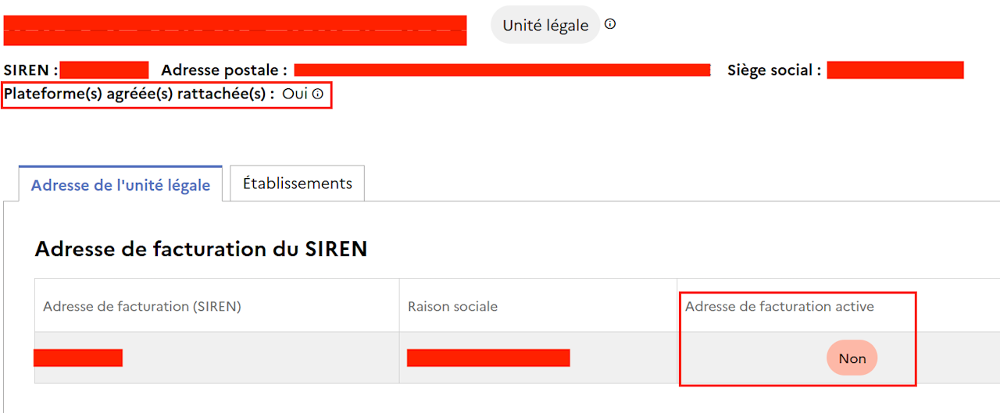

# Vérification Onboarding PA Septeo

Vous pouvez voir le statut de votre inscription via Qotid.

Voici le lien des annuaires public pour consulter votre statut :

[https://facturation.chorus-pro.gouv.fr/annuaire/#/](https://facturation.chorus-pro.gouv.fr/annuaire/#/)

## Vérification annuaire

L'adresse apparait en "Non" sur fond rouge car elle ne sera active qu'à partir du 1er septembre 2026. En revanche le "Oui" à côté de Plateforme(s( agréée(s) rattachée(s) confirme l'inscription.
