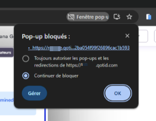
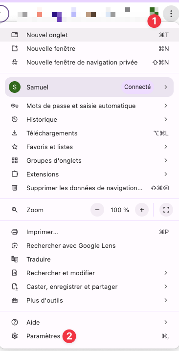
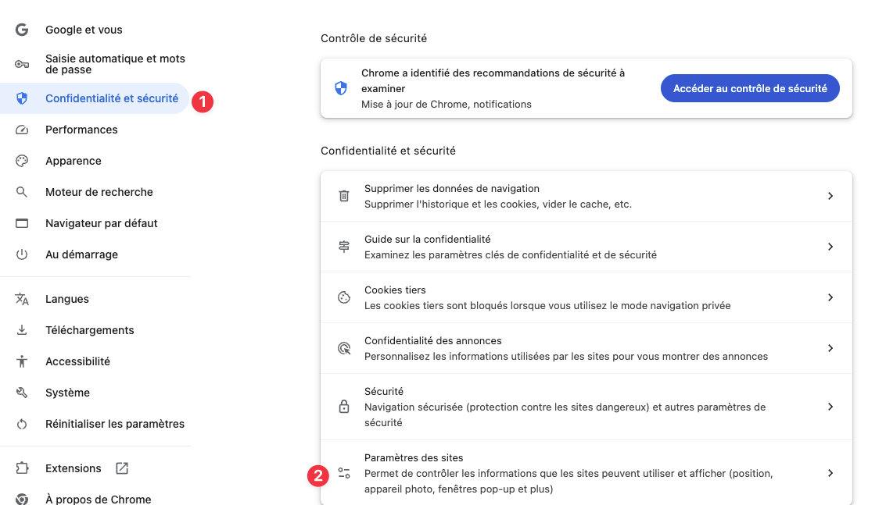
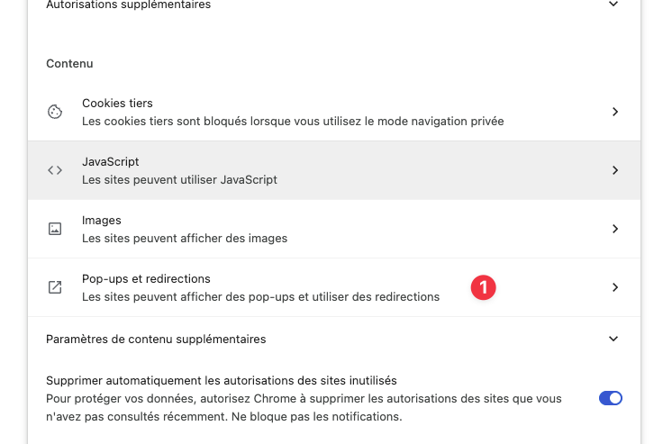
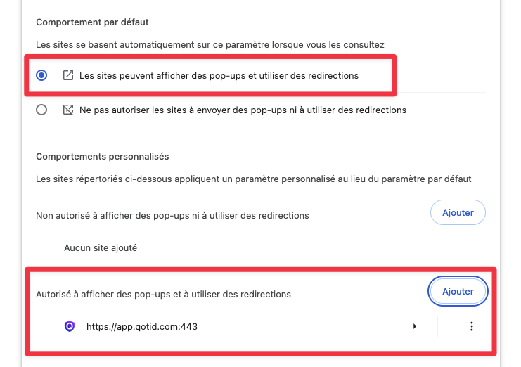
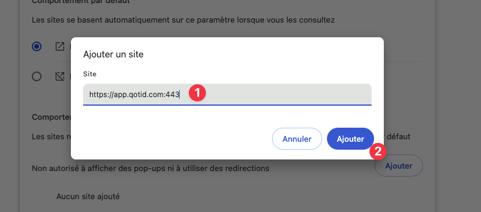

# Comment empêcher que mon navigateur bloque le téléchargement de documents depuis Qotid ?

## Téléchargement bloqué

Lorsque vous souhaiterez télécharger un document Excel depuis Qotid, il se peut que votre navigateur Google Chrome bloque le téléchargement de votre document.

Un pop-up s'affichera.

Dans ce cas, il faut bien sélectionner le champ : **Toujours autoriser les pop-ups et les redirections de https://www.qotid.com**

Puis cliquez sur **OK**.

Il existe une deuxième méthode.

## Téléchargement bloqué : deuxième méthode

Depuis votre navigateur Chrome, cliquez sur le menu de droite **...**

Puis **Paramètres**.

Ensuite **Confidentialité et sécurité**.

Puis sur **Paramètres des sites**.

Ensuite, cliquez sur **Pop-ups et redirections**.

## Autoriser Qotid à afficher des pop-ups et utiliser des redirections

Pour finir, assurez-vous d'avoir coché : **Les sites peuvent afficher des pop-ups et utiliser des redirections**.

Puis assurez-vous que, dans **Autorisé à afficher des pop-ups et à utiliser des redirections**, **Qotid soit affiché**.

Si ce n'est pas le cas, vous pouvez cliquer sur **Ajouter** et saisir : [https://app.qotid.com:443](https://app.qotid.com)

Puis cliquez sur **Ajouter**.
