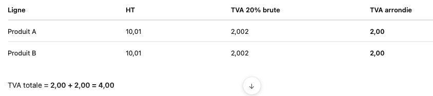
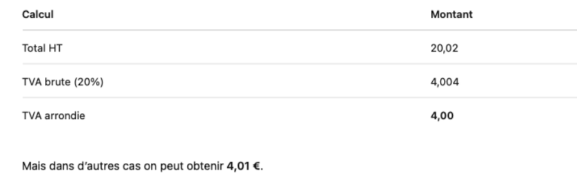

# Comment est calculé la TVA de mes factures de vente

## Les deux méthodes acceptées par l'administration fiscale

IL y a deux méthodes possibles:

1. La méthode de la somme des arrondis
2. La méthode de l'arrondi de la somme

**Attention :** **Sur Qotid nous utilisons la somme des arrondis**

## Somme des arrondis

Ici on calcule et arrondi la TVA **pour chaque ligne de facture**, puis on additionne

Ce schéma respecte les étapes suivantes:

1. On calcule la TVA de chaque ligne (prix HT x taux de TVA)
2. On arrondit chaque TVA au centime
3. On additionne toutes les TVA arrondies pour obtenir la TVA totale

**Attention :** Cette méthode est la plus courante dans les logiciels de facturation. **Elle est utilisée sur Qotid**

## Pourquoi il y a des écarts de TVA

Il peut y avoir des écarts car les calculs donnent souvent des fractions de centimes (ex: 2,002€)

Le fait d'arrondir avant ou après la somme change le résultat final

Les écarts sont généralement d'environ 0,01 centime. Parfois de quelques centimes s'il y a beaucoup de lignes

## L'arrondi de la somme

Ici on additionne d'abord les montants, puis on arrondit une seul fois.

Ce schéma respecte les étapes suivantes:

1. On calcule le total HT
2. On calcule la TVA sur ce total
3. On arrondit une seule fois l résultat final

**Attention :** Cette méthode **n'est pas** **utilisée** sur Qotid
